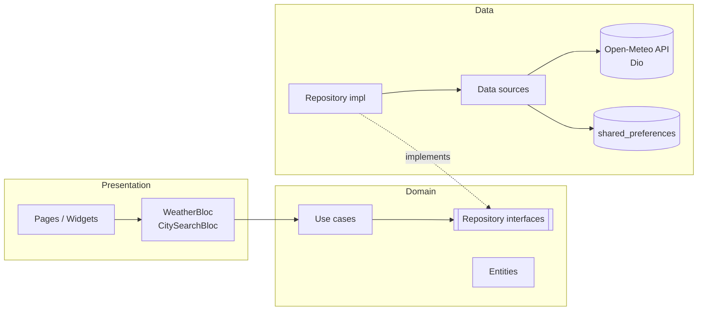

# clean_weather — погода на Flutter: Clean Architecture + BLoC

Приложение показывает текущую погоду, почасовой прогноз на сутки и прогноз на 7 дней
для любого города мира. Данные загружаются из открытого API
[Open-Meteo](https://open-meteo.com) (ключ не нужен).

## Возможности

- Поиск города по названию с задержкой ввода (debounce) и флагами стран.
- Погода сейчас: температура, «ощущается как», влажность, ветер, местное время.
- Почасовой прогноз на 24 часа и прогноз на неделю с вероятностью осадков.
- Последний выбранный город запоминается и открывается при следующем запуске.
- Обновление жестом «потянуть вниз»; если обновить не удалось, прежний прогноз остаётся на экране.
- Обработка ошибок: нет интернета, таймаут, ошибка сервера, неожиданный формат ответа.
- Адаптивная вёрстка (две колонки на планшете), светлая и тёмная тема.

## Архитектура

Проект разделён на три слоя по принципам Clean Architecture.
Зависимости направлены только внутрь: **presentation → domain ← data**.
Слой domain не зависит ни от Flutter, ни от Dio, ни от хранилища.



| Слой | Что содержит |
|---|---|
| **domain** | Сущности (`Location`, `Weather`, `WeatherCondition`), интерфейсы репозиториев, use case'ы (`GetWeather`, `SearchLocations`, `GetLastLocation`, `SaveLastLocation`). Чистый Dart. |
| **data** | Модели с `fromJson`/`toJson`, перевод кодов погоды WMO, удалённые источники (Dio) и локальный источник (shared_preferences), реализации репозиториев. |
| **presentation** | BLoC'и (события, состояния), страницы и виджеты. Работает только с use case'ами. |
| **core** | Общие классы: `Result` (Success / Failed), `Failure`, исключения, базовый `UseCase`, настройка Dio. |

### Обработка ошибок

```
DioException → (data source) NetworkException / ServerException
            → (repository)  Failed(NetworkFailure / ServerFailure)
            → (BLoC)        WeatherState(status: failure, errorMessage)
```

Исключения не выходят за пределы слоя data. Use case'ы возвращают sealed-тип
`Result<T>`, поэтому BLoC обязан обработать и успех, и ошибку (`switch` по типу).

### BLoC

- **WeatherBloc** — события `WeatherStarted`, `WeatherLocationSelected`, `WeatherRefreshRequested`.
  Трансформеры из `bloc_concurrency`: `restartable` при выборе города (старая загрузка отменяется),
  `droppable` при обновлении (повторные нажатия игнорируются).
- **CitySearchBloc** — событие `CitySearchQueryChanged`; debounce реализован через `restartable`
  и задержку перед запросом.

### Внедрение зависимостей

Все зависимости собираются в `lib/injection_container.dart` с помощью `get_it`.
Репозитории регистрируются под интерфейсами domain, BLoC'и — как factory.

## Структура

```
lib/
├── main.dart
├── injection_container.dart
├── core/
│   ├── error/          // exceptions.dart, failures.dart
│   ├── network/        // dio_client.dart
│   ├── result/         // result.dart, guard_result.dart
│   ├── usecase/        // usecase.dart
│   └── utils/          // date_formatter.dart
└── features/weather/
    ├── domain/         // entities, repositories (интерфейсы), usecases
    ├── data/           // models, mappers, datasources, repositories (реализации)
    └── presentation/   // bloc, pages, widgets
test/                   // тесты моделей, репозитория и обоих BLoC
```

## Пакеты

`flutter_bloc`, `bloc_concurrency`, `equatable`, `get_it`, `dio`, `shared_preferences`;
для тестов `bloc_test` и `mocktail`.

## Запуск

```bash
flutter create .   # создаст папки платформ (android, ios, web…), код в lib/ не изменится
flutter pub get
flutter run
```

Тесты: `flutter test`

Для release-сборки Android добавьте в `android/app/src/main/AndroidManifest.xml`
разрешение `<uses-permission android:name="android.permission.INTERNET"/>`
(в debug-сборке оно есть по умолчанию).
